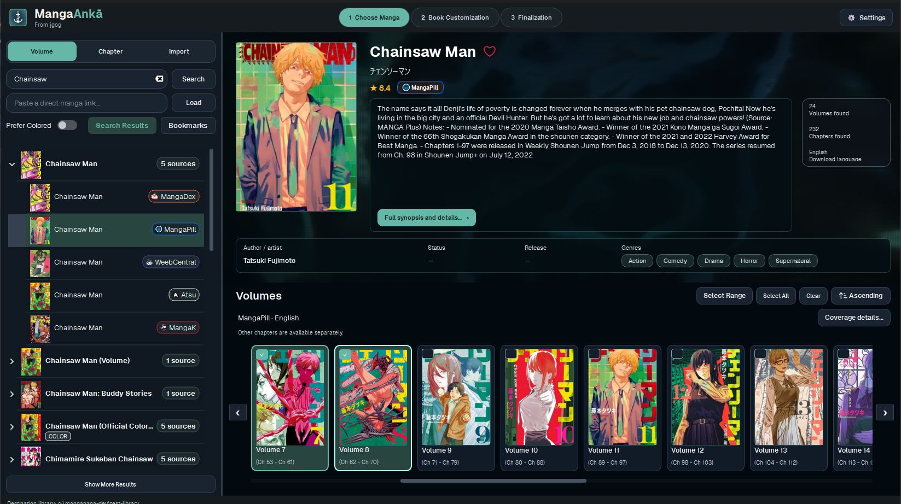
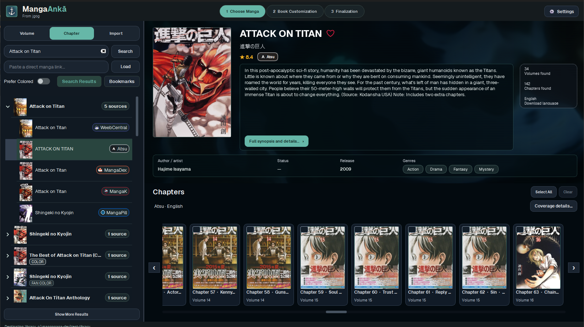
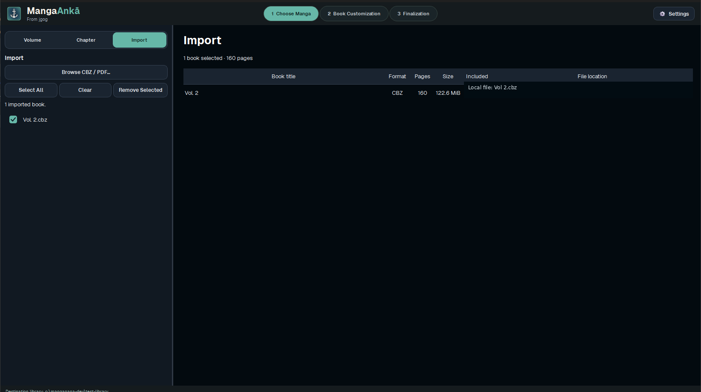
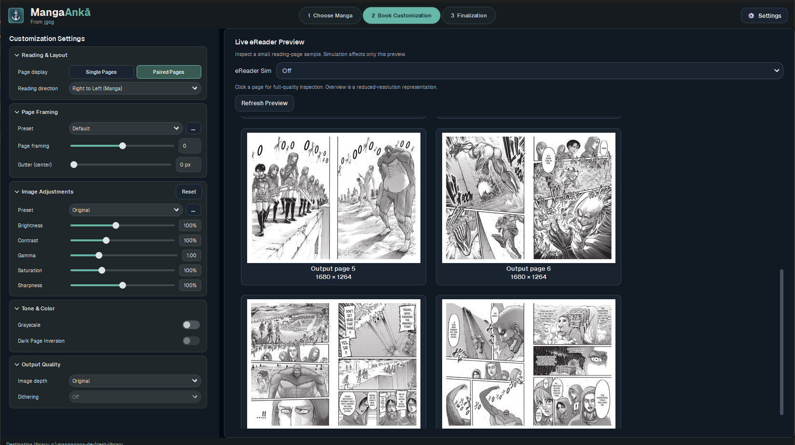
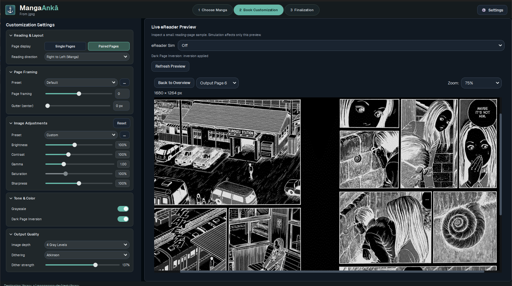
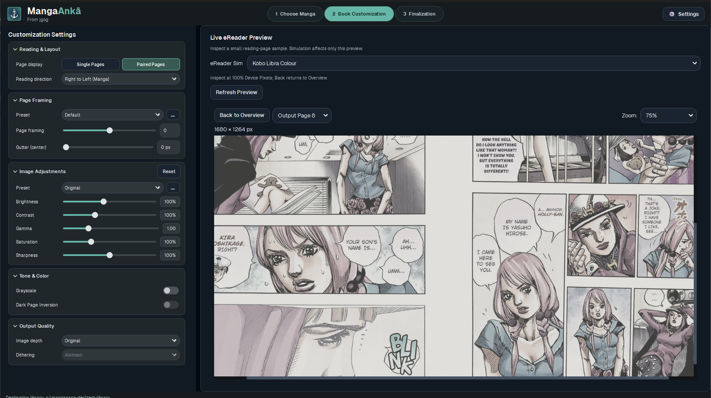
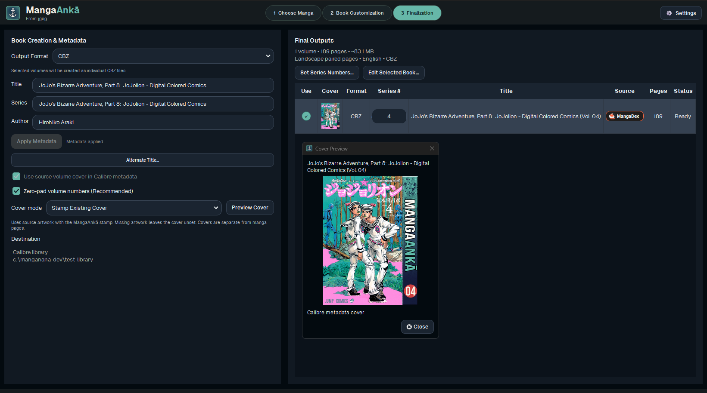
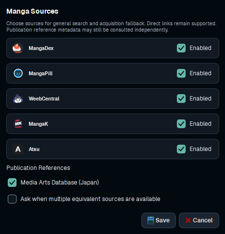
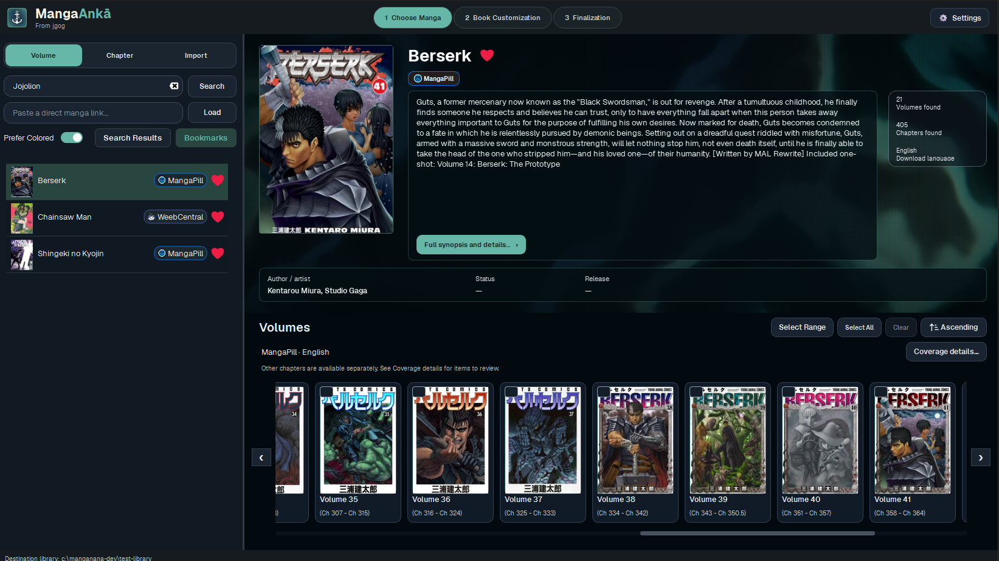

<h1 align="center">MangaAnkā</h1>

  <strong>Discover, customize, and add manga to calibre.</strong>

  Search multiple manga sources, download volumes or chapters, or prepare your own CBZ and PDF files. Preview the result and add finished books directly to your calibre library.

  <a href="https://github.com/jgog2/MangaNana-calibre/releases">Download from GitHub Releases</a>
  ·
  <a href="https://github.com/jgog2/MangaNana-calibre/issues">Report an issue</a>

## Volume search & downloading

Search across supported manga providers, browse publication volume groups, and select individual books or ranges. Volume covers, chapter coverage, and source information help you decide exactly what to add.

## Chapter mode

Switch to individual chapters to collect specific entries, extras, or material outside a full volume. Chapter identities and available volume associations stay visible throughout selection.

## Import your own CBZ and PDF files

Bring existing CBZ and PDF books into the same customization and calibre workflow. Review the selected files before preparing their metadata and output.

## Page customization

Adjust reading direction, paired pages, framing, brightness, contrast, gamma, and output quality. The live preview lets you inspect a sample before creating the finished book.

## Dark page inversion

Preview dark-page inversion alongside grayscale and dithering settings. These options help tailor reading pages for different display preferences and eReaders.

## eReader and eInk simulation

Inspect your pages with device-oriented preview settings, including the Kobo Libra Colour simulator. Check readability and image treatment before exporting.

## Cover stamping & book metadata

Edit titles, authors, series numbers, and covers before import. Optional cover stamping identifies the volume or chapter directly on the cover, making finished books easier to recognize in calibre.

## Provider tags & source settings

Use MangaDex, MangaPill, WeebCentral, MangaK, and Atsu, with identifiable source badges throughout browsing. Enable or disable providers from Settings while keeping publication-reference options separate from the download source.

## Bookmarks

Heart a specific manga entry from a specific provider to save it for later. Return to your saved titles in the Bookmarks view without repeating a search.

## Install

Download the **calibre plugin ZIP** from [Releases](https://github.com/jgog2/MangaNana-calibre/releases). In calibre, open **Preferences → Plugins → Load plugin from file**, select the ZIP, and restart calibre if prompted. **Do not extract the plugin ZIP.**

MangaAnkā runs as a calibre plugin. Online access and available material depend on each provider. Some metadata integrations, including Google Books, are optional.

## Compatibility and feedback

MangaAnkā 1.0.0 — The World is a release candidate. Windows testing uses Calibre 9.13.0; Linux/macOS remain unqualified. The package still declares Calibre 7.0+, but a prior Calibre 7.0 native-startup failure remains unresolved. See [COMPATIBILITY.md](COMPATIBILITY.md) for version, resource-growth and upgrade limitations. For problems, open a [GitHub issue](https://github.com/jgog2/MangaNana-calibre/issues) and include your calibre version, operating system, steps to reproduce, and relevant Activity Log output.

## License

See the [repository LICENSE](LICENSE) for terms. Third-party manga content and artwork remain the property of their respective owners.

## Build and contribute

This repository contains the organized plugin source. Build the installable ZIP with `python tools/build_plugin.py`; output goes to the neighboring `builds` directory. The source archive is not an installable Calibre plugin. Internal `MangaNana` storage/plugin names stay unchanged for upgrades.

- [Building and isolated testing](BUILDING.md)
- [Contributing](CONTRIBUTING.md)
- [Adding a provider](PROVIDER_DEVELOPMENT.md)
- [Architecture](ARCHITECTURE.md)
- [Release checklist](RELEASE_CHECKLIST.md)
- [Third-party notices](THIRD_PARTY_NOTICES.md) and [asset provenance](ASSET_PROVENANCE.md)
